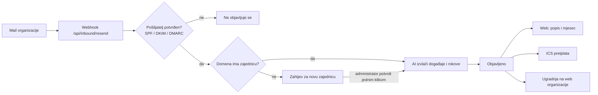

# Rokovnik

Događaji i rokovi zajednica na jednom mjestu. Organizacija objavljuje tako da **pošalje običan mail**; sustav ga prema domeni pošiljatelja svrsta u zajednicu, iz teksta izvuče događaje i rokove i **objavi ih automatski**. Posjetitelji ih prate na webu ili ih jednim klikom dodaju u svoj kalendar.

Radni naziv projekta bio je „Publish.me”. Ime se mijenja na jednom mjestu: `NEXT_PUBLIC_APP_NAME` (ili `src/lib/config.ts`).

## Kako radi



- **Svrstavanje po domeni.** Mail s `@fsb.unizg.hr` ide u zajednicu vezanu uz tu domenu. Za javne servise (gmail.com i slične) pravilo se veže uz točnu adresu. Poddomene se ne svrstavaju automatski pod širu domenu: za njih nastaje zahtjev, uz podsjetnik da slična domena već ima zajednicu.
- **Nova zajednica.** Prvi mail s nepoznate domene otvara zahtjev. Administrator dobije mail s poveznicom (ili ga vidi u `/admin`) i samo potvrdi predloženo ime. Mailovi koji su čekali tada se obrade i objave, a svi budući s te domene idu bez potvrde. Odbijen pošiljatelj ostaje blokiran.
- **Prosljeđivanje.** Kad povjerljiva adresa (`ADMIN_EMAIL`, `FORWARDER_EMAILS`) proslijedi tuđi mail, zajednica se određuje prema izvornom pošiljatelju iz proslijeđene poruke.
- **Bez ručnog odobravanja objava.** Objave idu van odmah. Administrator ih naknadno može sakriti ili ponovno obraditi mail.
- **Ispravak.** Novi mail s istim naslovom i datumom ažurira postojeću objavu; pretplaćeni kalendari je ažuriraju, ne dupliciraju (stabilan UID, rastući SEQUENCE).

## Što posjetitelj dobiva

- **Popis po danima** (zadani prikaz, prilagođen mobitelu) i **mjesec**; filtar *sve / događaji / rokovi*. Rokovi su istaknuti crvenom.
- **Klik na događaj otvara opis**, a na dnu je **„Dodaj u moj kalendar”** (Google, Outlook.com, Microsoft 365, Apple i ostali preko .ics). Izbor aplikacije se pamti, pa je svako sljedeće dodavanje jedan klik.
- **„Prati u svom kalendaru”**: pretplata na cijeli kalendar zajednice (ICS). Nema integracije s pojedinim kalendarima; koristi se adresa za pretplatu koju svi podržavaju.
- **Moj kalendar**: izbor više zajednica u jedan kalendar i jednu pretplatu, bez korisničkog računa (izbor se pamti na uređaju).
- **Ugradnja**: `/ugradi/<zajednica>` za iframe na stranici organizacije.

## Lokalno pokretanje

Treba samo Node 22 i pnpm. Baza, AI ključ i mail **nisu potrebni**:

```bash
pnpm install
pnpm db:seed      # tri zajednice s izmišljenim objavama (samo lokalno)
pnpm dev          # http://localhost:3000
```

- Bez `DATABASE_URL` koristi se ugrađeni Postgres (PGlite) u mapi `.data/`.
- Bez `ANTHROPIC_API_KEY` mailovi se čitaju jednostavnim pravilima (hrvatski zapisi datuma i vremena). Dovoljno za isprobavanje, ali za stvarne okružnice treba AI.
- Administracija: `/admin`, lokalna lozinka je `rokovnik`. Tamo je i obrazac **Testni mail**, koji prolazi istu obradu kao pravi mail.

Testni mail iz terminala, kroz HTTP ulaz:

```bash
INBOUND_SECRET=tajna pnpm dev
INBOUND_SECRET=tajna pnpm mail:test --from "Okružnica <okruznica@fsb.unizg.hr>" \
  --subject "Gostujuće predavanje" --text "Predavanje je 15. 12. 2026. u 14:15 u dvorani A. Prijave do 10. 12."
```

## Provjere

```bash
pnpm test        # 38 testova: vrijeme i ljetno računanje, svrstavanje, prosljeđivanje, ICS, potpisi, cijeli tok maila
pnpm lint && pnpm typecheck && pnpm build
```

Testovi cijelog toka (`tests/pipeline.test.ts`) rade nad pravom Postgres shemom u memoriji, s lažnim AI odgovorom.

## Postavljanje online

Upute korak po korak: [DEPLOY.md](DEPLOY.md). Sve postavke: [.env.example](.env.example).

## Struktura

| Putanja | Sadržaj |
|---|---|
| `src/lib/pipeline.ts` | Tok maila: provjera pošiljatelja, zajednica, zahtjev, izvlačenje, objava |
| `src/lib/sender.ts` | Domene, javni mail servisi, prepoznavanje proslijeđene poruke |
| `src/lib/extract/` | Izvlačenje: `llm.ts` (Claude API, strukturirani izlaz), `heuristic.ts` (pravila bez AI-ja) |
| `src/lib/ics.ts`, `calendar-links.ts` | ICS (RFC 5545) i poveznice „Dodaj u kalendar” |
| `src/lib/resend.ts` | Primanje (webhook, dohvat maila i privitaka) i slanje maila |
| `src/db/schema.ts`, `drizzle/` | Shema i migracije (Drizzle) |
| `src/app/(site)/` | Stranice: početna, `/z/<zajednica>`, `/d/<objava>`, `/moj`, `/objavi`, `/admin`, `/potvrdi/<token>` |
| `src/app/ics/`, `src/app/ugradi/`, `src/app/api/` | Kalendari za pretplatu, ugradnja, webhookovi |

## Odluke

- **Next.js + Postgres preko Drizzlea**, bez vezanja uz jednog pružatelja: ista aplikacija radi na Supabaseu, Neonu ili lokalno na PGliteu.
- **Resend za primanje maila** umjesto vlastitog mail poslužitelja: daje gotovu adresu `…@<id>.resend.app`, pa za prve testove ne treba ni vlastita domena.
- **Bez korisničkih računa** u ovoj fazi: praćenje ide preko pretplate na kalendar i izbora na uređaju. Jedini račun je administratorski (lozinka + potpisani kolačić).
- **Poveznica za potvrdu zajednice** je potpisana (HMAC) i vodi na stranicu s gumbom; sama poveznica ništa ne mijenja, da je čitači maila ne „potvrde” slučajno.
- **Sadržaj maila je nepovjerljiv ulaz**: AI dobiva izričitu uputu da ne slijedi upute iz maila, izlaz je strogo strukturiran i provjeren (zod), poveznice smiju biti samo http(s), a tekst se prikazuje kao običan tekst.

## Što još nije izgrađeno

- Tjedni e-mail sažetak i podsjetnici pred rok.
- Potvrda pošiljatelju („Vaš događaj je objavljen”).
- Sučelje na engleskom.
- Korisnički računi i preporuke.
- Uređivanje teksta objave u administraciji (zasad: sakrij ili pošalji ispravljeni mail).
